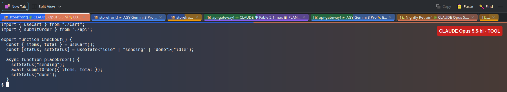
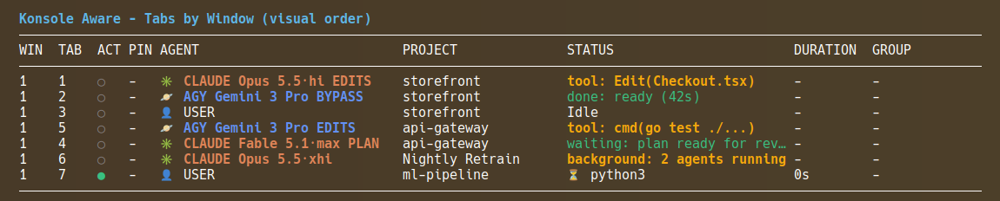
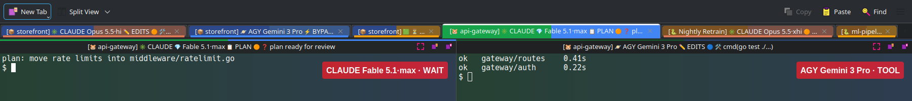
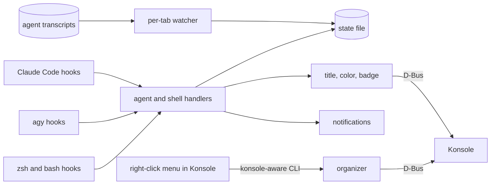

# konsole-aware

konsole-aware puts the state of your AI coding agents and long shell jobs into KDE Konsole's tab titles, tab colors
and badges. Each tab says which agent is in it (Claude Code, Antigravity, Gemini, Codex and others), which model and
effort that agent is on, and whether it is working, done, or waiting on you. A plain shell says it is a plain shell.



That screenshot has three projects. The selected `storefront` Claude tab is editing `Checkout.tsx` in accept-edits
mode, and its terminal is tinted with the tab's colors. The agy tab next to it finished in 42 seconds, and the third
`storefront` tab is a plain shell running a dev server. The `api-gateway` Claude tab is in plan mode on Fable 5.1 at
max effort, waiting for its plan to be approved. The `Nightly Retrain` tab is a Claude session named with `/rename`,
with two background agents still running.

## Contents

- [What it does](#what-it-does)
- [Install](#install)
- [Set up your user](#set-up-your-user)
- [Reading a tab](#reading-a-tab)
- [Commands](#commands)
- [Tab right-click menu](#tab-right-click-menu)
- [Configuration](#configuration)
- [Environment variables](#environment-variables)
- [How it works](#how-it-works)
- [Testing](#testing)
- [Building the packages](#building-the-packages)
- [Updating](#updating)
- [Troubleshooting](#troubleshooting)
- [Uninstall](#uninstall)
- [Contributing](#contributing)
- [License](#license)

## What it does

- Starts every tab title with the agent in it (`CLAUDE`, `AGY`, `GEMINI`, `CODEX`, `AIDER` and a few more), or `USER`
  when no agent is running.
- Shows the model and effort next to it (`Fable 5.1·max`, `Opus 5.5·hi`) and keeps them current when you switch with
  `/model` or `/effort`, or when Claude Code switches on its own.
- Shows the permission mode for all six Claude Code modes (plan, acceptEdits, auto, dontAsk, bypassPermissions,
  default) and agy's `--mode` and `--dangerously-skip-permissions`.
- Tracks 18 Claude Code hook events and the four agy hook events: thinking, running a tool, subagents, compacting,
  waiting for your answer, done, failed.
- Has its own states for safeguard blocks and usage limits, so a blocked or rate-limited tab doesn't look finished.
- Shows ultracode, background agents, workflows and shells, so a turn with work still running doesn't read as done.
- Uses a Claude Code session's name (`/rename`) or an agy `--project` as the project name.
- Gives every project its own color and fills the tab with it, two-tone with the agent's color by default. The
  selected tab stands out, and each terminal's background is tinted to match its tab.
- Puts tabs of the same project next to each other (Claude first, then agy) and can merge them into one split tab.
- Tracks ordinary shell commands too: builds, tests, transfers, package managers, ssh, dev servers, `tail -f`, with exit
  codes and run times.
- Sends a desktop notification when a tab you aren't looking at finishes or needs you, at most 4 per 20 seconds
  across all tabs.

It only watches. The agent hooks never approve, deny or change a tool call, and they never print anything into the
agent's context.

`konsole-aware list` shows the same information as a table:



## Install

You need KDE Konsole 24.02 or newer and Python 3.8 or newer. It's tested on Konsole 26.08 with Plasma 6 on Wayland.

### One line

```bash
curl -fsSL https://raw.githubusercontent.com/sworrl/konsole-aware/HEAD/get.sh | bash
```

This clones the repo into `~/.local/share/konsole-aware` (or updates it if it's already there) and sets things up for
your user. It needs `git` and `python3`. To build the right-click menu it also needs `g++`, `make` and the Qt 6
headers; without them everything else still installs and the menu is skipped.

To skip the menu on purpose:

```bash
curl -fsSL https://raw.githubusercontent.com/sworrl/konsole-aware/HEAD/get.sh | bash -s -- --no-menu
```

### Debian, Ubuntu, KDE neon (.deb)

Download the `.deb` from the [latest release](https://github.com/sworrl/konsole-aware/releases/latest), then:

```bash
sudo apt install ./konsole-aware_1.2.0_amd64.deb
konsole-aware install
```

### Fedora (.rpm)

Download the `.rpm` from the [latest release](https://github.com/sworrl/konsole-aware/releases/latest), then:

```bash
sudo dnf install ./konsole-aware-1.2.0-1.*.x86_64.rpm
konsole-aware install
```

The packages put the program in `/usr/lib/konsole-aware` with the right-click menu already built, so no compiler is
needed. A package can't edit your shell config or your Claude Code settings, so each user runs `konsole-aware install`
once after installing it.

### From source

```bash
git clone https://github.com/sworrl/konsole-aware.git
cd konsole-aware
./install.sh
```

The clone is the install (the installer links to it), so keep it somewhere it can stay.

### Optional extras

| Package | What it's for |
| :--- | :--- |
| `python3-gi` (Debian/Ubuntu), `python3-gobject` (Fedora) | Fast D-Bus. Without it every call to Konsole starts a `qdbus6` process |
| `libnotify-bin` / `libnotify` | Desktop notifications (`notify-send`) |
| `pulseaudio-utils` or `pipewire-bin` | Notification sounds (`paplay` or `pw-play`) |
| `g++`, `make`, `qt6-base-dev` / `qt6-qtbase-devel` | Building the right-click menu from source |

## Set up your user

`konsole-aware install` (which `install.sh` and the one-line installer run for you) does this:

| File | Change |
| :--- | :--- |
| `~/.claude/settings.json` | Adds konsole-aware's hooks for 18 Claude Code events. Your other hooks stay, and the original file is copied once to `settings.json.konsole-aware.bak` |
| `~/.gemini/config/hooks.json` | Adds a `konsole-aware` hook group for agy. Other groups stay |
| `~/.zshrc`, `~/.bashrc` | Adds one line each, tagged `# konsole-aware`, that loads the shell integration |
| `~/.local/bin/konsole-aware` | Link to the program (source and one-line installs only) |
| `~/.local/lib/libkonsole_aware_menu.so`, `~/.local/bin/konsole`, `~/.local/share/applications/org.kde.konsole.desktop` | The right-click menu library, a launcher that loads it, and a desktop entry that uses the launcher |

Running it again replaces only its own entries.

Expected output:

```text
✓ Installed binary: /home/you/.local/bin/konsole-aware
✓ Configured Antigravity lifecycle hooks: /home/you/.gemini/config/hooks.json
✓ Configured Claude Code hooks (18 events): /home/you/.claude/settings.json
✓ Added shell integration to /home/you/.zshrc
✓ Installed context menu hook library: /home/you/.local/lib/libkonsole_aware_menu.so
✓ Installed konsole wrapper with menu hook: /home/you/.local/bin/konsole
✓ Installed desktop application entry: /home/you/.local/share/applications/org.kde.konsole.desktop

Install finished.
Reload your shell with 'source ~/.zshrc', or open a new Konsole tab.
```

Then:

1. Quit every Konsole window and start Konsole again from the app launcher. The right-click menu only loads when
   Konsole starts from the launcher. A Konsole that Plasma restores at login starts without it.
2. Open a new tab, or run `source ~/.zshrc` in the ones you have open.
3. Start `claude` or `agy` in a project. The tab should change to `CLAUDE …` or `AGY …` at the first prompt.
4. Run `konsole-aware list` to see every tab.

## Reading a tab

```text
[🐹 api-gateway] ✳️ CLAUDE 💎 Fable 5.1·max 📋 PLAN 🚀 ULTRA ❓ plan ready for review
└──────┬──────┘ └──┬────┘ └──────┬───────┘ └──┬──┘ └───┬──┘ └─────────┬───────────┘
    project       agent     model·effort     mode   extras      state and detail
```

A plain shell reads `👤 USER [🐍 konsole_aware] 💤` at the prompt, and shows the command while one runs
(`[📦 storefront] 🟡 ⏳ cargo build`). The badge in the top right of the terminal repeats agent, model and state in
plain text, like `CLAUDE Opus 5.5·hi · TOOL`.

The project comes first so you can see what each tab is working on at a glance. Change the
order with `title_order` in the config (see [Configuration](#configuration)).

The project is the folder's Git root or project root, unless the agent session has a name. A Claude Code session
named with `/rename` or `--name` shows that name, and so does an agy session started with `--project`. Claude's own
automatic names (the folder name plus a suffix) are ignored. agy's conversation titles are not used either: agy writes
one for every conversation, and a `/rename` there can't be told apart from them. `set-job` still overrides all of this.

The extras slot shows work happening around the agent:

| Tag | Meaning |
| :--- | :--- |
| `🚀 ULTRA` | Claude Code's ultracode mode is on (`/effort ultracode`). Read from the transcript, since hooks don't carry it; it resets on restart |
| `⧗3 bg` | Workflows, background agents, background shells or monitors still running |
| `👥2` | Agent-team teammates |

When a turn ends while background work is still running, the tab shows
`⧗ 1 workflow, 2 agents running` instead of done, and goes to done once Claude Code reports nothing in flight.

When one tab holds several agents (after `attach` or `pair`), every pane gets the same combined title, for example
`[🐍 konsole_aware] ✳️ CLAUDE 🛠️ Edit(app.py) │ [🐍 konsole_aware] 🪐 AGY ✅ ready (40s)`. Konsole only shows the
focused pane's title, so this keeps both visible. Each pane keeps its own header and badge:



### Agent states

| State | Shows | Tab color | Claude Code event | agy event |
| :--- | :---: | :--- | :--- | :--- |
| Ready | `💤` | agent color | `SessionStart` | |
| Thinking | `🧠` | agent color | `UserPromptSubmit`, `PostToolUse` | `PreInvocation`, `PostToolUse` |
| Running a tool | `🛠️` | agent color | `PreToolUse` | `PreToolUse` |
| Subagents | `🤖` | agent color | `SubagentStart`, `SubagentStop` | |
| Compacting | `🗜️` | agent color | `PreCompact`, `PostCompact` | |
| Waiting on you | `❓` | purple | `AskUserQuestion`, `ExitPlanMode`, `PermissionRequest`, permission `Notification`, `Elicitation` | `ask_question` |
| Done | `✅` | agent color | `Stop` | `Stop` |
| Background work | `⧗` | agent color | `Stop` with `background_tasks` still running | |
| Failed | `❌` | red | `StopFailure` | `Stop` with an error |
| Blocked by safeguards | `🛡️` | pink | `StopFailure` or `Stop`, plus a refusal in the transcript | |
| Usage limit | `⌛` | orange | `Stop` with "You've hit your … limit" | |
| Interrupted | `❓` | agent color | Esc, read from the transcript | |
| Agent exited | `USER` | default | `SessionEnd`, or the shell prompt coming back | the shell prompt coming back |

Waiting only shows while a question, plan approval or permission prompt is actually open. If the agent finished and
its last message happened to ask you something, the tab shows done.

### Modes, models and effort

| Claude Code `permission_mode` | Tag | | agy flag | Tag |
| :--- | :--- | :-- | :--- | :--- |
| `default` | none | | `--mode plan` | `📋 PLAN` |
| `plan` | `📋 PLAN` | | `--mode accept-edits` | `✏️ EDITS` |
| `acceptEdits` | `✏️ EDITS` | | `--dangerously-skip-permissions` | `⚡ BYPASS` |
| `auto` | `🤖 AUTO` | | | |
| `dontAsk` | `🔕 DONT-ASK` | | | |
| `bypassPermissions` | `⚡ BYPASS` | | | |

Model names get shortened (`claude-opus-5-5` to `Opus 5.5`, `gemini-3-pro` to `Gemini 3 Pro`) and effort to `lo`,
`med`, `hi`, `xhi` or `max`. Fable models get a diamond so you notice when you're burning through a Fable limit.

### Safeguard blocks and model switches

| What happened | The tab shows |
| :--- | :--- |
| A safeguard stopped the turn ("API Error: …'s safeguards flagged this message") | `🛡️ blocked by safeguards [cyber] · rephrase or /model`, pink tab, `BLOCKED` badge, notification |
| A safeguard flagged the request and Claude Code carried on with another model | `🛡️ flagged [cyber]: Fable 5.1 → Opus 4.8` while it works, then `ready (2m 3s) · 🛡️ on Opus 4.8` |
| Claude Code switched models for some other reason (overload, unavailable) | `switched: A → B` |

Blocks come from the hook payload and the current turn's transcript entries (`stop_reason: "refusal"`,
`stop_details.category`). A reply that just talks about safeguards doesn't count as a block.

### Shell commands

| Kind | Examples | The tab shows |
| :--- | :--- | :--- |
| Build | `cargo build`, `make`, `ninja`, `npm run build` | `🟡 ⏳ cargo build` |
| Test | `pytest`, `cargo test`, `go test`, `npm test`, `python -m pytest` | `🟢 ⏳ pytest -q` |
| Transfer, download | `rsync`, `scp`, `rclone`, `curl`, `wget`, `yt-dlp` | `🟠 ⏳ rsync -> backup` |
| Package manager | `apt`, `nala`, `dnf`, `pacman`, `zypper`, `snap`, `flatpak`, `brew` | `🟦 ⬆️ apt full-upgrade` |
| Remote shell | `ssh`, `mosh`, `et` | `🔐 ssh nas` |
| Dev server | `vite`, `uvicorn`, `flask`, `npm run dev`, `python -m http.server` | `🌐 http.server :8000` |
| Monitor | `tail -f`, `journalctl -f`, `htop`, `btop`, `watch` | `👀 tail syslog` |
| Interactive | `vim`, `nvim`, `less`, `lazygit`, `psql`, `python3` with no script | `✏️ vim notes.md` |
| Git, containers, archives | `git`, `docker`, `kubectl`, `tar` | `🔵 ⏳ git rebase` |

Commands that take under 3 seconds just go back to the normal prompt title. Longer ones end as
`✅ cargo build (1m 12s)` or `❌ pytest (exit 1)` and notify you if that tab isn't the one you're looking at.
Quitting an editor, monitor, server or ssh session never notifies.

## Commands

Anything that acts on a tab uses the current tab unless you pass `--tab <session>`. From outside Konsole, also pass
`--service`, for example `--service org.kde.konsole-1234`.

### Looking

| Command | What it does |
| :--- | :--- |
| `konsole-aware list` | One row per tab, in tab order: agent, model, mode, project, state, run time, group |
| `konsole-aware list --json` | Same, as JSON |
| `konsole-aware list --service S` | Only one Konsole instance |
| `konsole-aware watch` | `list`, updating every second |
| `konsole-aware icon [--path DIR]` | Which icon a folder gets, and why |

### Arranging tabs

| Command | What it does |
| :--- | :--- |
| `konsole-aware snap` | In every window, puts tabs of the same project together, agents first |
| `konsole-aware snap --window 2 --dry-run` | Prints the new order for window 2 without moving anything |
| `konsole-aware organize --by status\|group\|name\|project\|id` | Sorts a window's tabs; pinned tabs stay at the front |
| `konsole-aware move <session> left\|right\|first\|last\|<index>` | Moves one tab |
| `konsole-aware attach --to <session>` | Moves this tab into another tab as a side-by-side split (same window) |
| `konsole-aware pair` | Puts this project's agent tabs into one split tab, Claude on the left |
| `konsole-aware detach-pane` | Moves one pane of a split tab out into its own window |
| `konsole-aware detach` | Moves the tab into a new window |
| `konsole-aware split [left-right\|top-bottom]`, `equalize`, `maximize-split` | Split view |
| `konsole-aware anchor`, `unanchor` | Pins a tab to the front of its window |
| `konsole-aware switch <session>` | Focuses a tab |

### Tab colors and patterns

Konsole on its own only draws a thin colored line under a tab title. With the right-click menu library loaded,
konsole-aware fills the whole tab:

| Pattern | What it looks like |
| :--- | :--- |
| `project-status` (default) | Two-tone: the project's color on the left, the agent or state color on the right. Plain shells get the solid project color |
| `two-tone` | Two colors, split down the middle |
| `gradient` | A smooth blend through two or more colors |
| `rainbow` | A full spectrum |
| `stripes` | Diagonal stripes of two or more colors |
| `solid` | One color |

The selected tab is drawn at full strength, fills its whole cell down to the terminal, and has an accent bar along
its top edge. Other tabs are drawn softer (`tab_pattern_opacity`). Titles are drawn in black or white, whichever reads
better on the pattern.

The tab's colors carry into its terminal: the background is tinted with them (`terminal_tint`), and a thin strip of
the pattern runs along the top of the terminal (`terminal_band`). On a dark color scheme the tint lifts the background
toward the color; on a light one it darkens it, and text keeps its contrast either way. In a split tab every pane
uses the tab's colors, so tabs joined with Attach Tab To… or `pair` share one color, and the focused pane's strip is
drawn brighter than the others.

Colors belong to the tab and follow it when you drag it. To color tabs by position instead (first tab one color,
second the next, so dragging recolors them), run `konsole-aware colors position on`, or tick Colors Follow Tab
Position in the Tab Pattern menu. `konsole-aware colors position off` switches back.

Every project gets its own color the first time it shows up in a tab. Colors are picked from 16 well-separated hues,
so neighboring projects don't look alike, and are remembered in `~/.config/konsole-aware/project-colors.json`.

| Command | What it does |
| :--- | :--- |
| `konsole-aware colors` | Lists project colors with a preview |
| `konsole-aware colors auto` | Gives every open project a color and snaps each project's tabs together (`--no-snap` to only color) |
| `konsole-aware colors set storefront "#ff5500" violet --pattern gradient` | Your own colors and pattern for a project |
| `konsole-aware colors reset storefront` | Back to an automatic color |
| `konsole-aware tab-style rainbow` | One tab only: `solid`, `two-tone`, `gradient`, `rainbow`, `stripes` |
| `konsole-aware tab-style gradient "#2563eb" "#db2777"` | One tab with your own colors |
| `konsole-aware tab-style --clear` | That tab goes back to its project's pattern |

The same choices are in the right-click menu under Tab Pattern, including a Custom Gradient… item that opens a color
picker. Set `"tab_pattern": "none"` to turn the fills off and keep Konsole's line.

### Names and colors

| Command | What it does |
| :--- | :--- |
| `konsole-aware set-job "Indexer" [--icon ⚡]` | Fixed project name for a tab; `--clear` goes back to automatic |
| `konsole-aware set-icon 🦀`, `set-icon --clear` | Fixed icon for a tab |
| `konsole-aware set-folder-icon contracts 📜` | Icon for every folder with that name; `--list` shows them all |
| `konsole-aware group set backend --color blue --icon ⚙️` | Tab groups; also `remove`, `list`, `auto` |
| `konsole-aware set-color amber`, `set-color reset` | Tab color by name or hex |
| `konsole-aware set-title "text"`, `reset` | Your own title, or back to Konsole's default |
| `konsole-aware refresh` | Redraws every open tab, for example after changing the config |

### Setup

| Command | What it does |
| :--- | :--- |
| `konsole-aware install [--no-menu]` | Sets up hooks and shell integration for your user |
| `konsole-aware uninstall` | Takes them back out |
| `konsole-aware alert "Title" "Body" [--error]` | Sends a test notification |
| `konsole-aware daemon` | Optional background poller for shells that don't load the integration |

`konsole-aware agent`, `preexec`, `precmd` and `watchdog` are called by the hooks.

## Tab right-click menu

Right-click a tab (in a Konsole started from the launcher):

| Item | What it does |
| :--- | :--- |
| Attach Tab To… | Right under Konsole's own Detach Tab. Lists the other tabs in the window by title; pick one and this tab becomes a split inside it. Also has Pair This Project's Agents Side by Side, and Split This Pane Out to a New Window |
| Snap Project Tabs Together | `snap` for this window |
| Anchor / Pin Tab, Unpin Tab | Pins the tab to the front |
| Tab Color, Tab Pattern, Assign Group, Project Name, Tab Icon | Per-tab settings. Tab Pattern also has Colors Follow Tab Position |
| Send Tab To… | Moves the tab, with whatever is running in it, to another Konsole window |
| Split View, Organize Tabs, Refresh All Tabs | Window actions |

Everything acts on the tab you right-clicked, not the one that happens to be active. The menu library also makes
Konsole cut long tab titles at the end instead of the start, so the agent name stays visible when tabs get narrow.

> [!WARNING]
> The menu library calls Konsole's internal `TabbedViewContainer` code, looked up when Konsole starts. Items it can't
> find are grayed out instead of crashing Konsole. A Konsole upgrade can still change those internals, so reinstall
> after upgrading Konsole.

## Configuration

Settings live in `~/.config/konsole-aware/config.json`, created with the defaults the first time it runs. Run
`konsole-aware refresh` after you edit it. If the file has a JSON error, konsole-aware uses the defaults and leaves
your file alone.

```json
{
  "tab_color_mode": "status",
  "agent_order": ["agy", "claude"],
  "model_icons": {"fable": "", "opus": "🟣"},
  "notification_timeout_seconds": 6
}
```

| Key | Default | What it does |
| :--- | :--- | :--- |
| `show_agent_identity` | `true` | Agent name at the start of the title |
| `show_agent_model` | `true` | Model and effort |
| `show_agent_mode` | `true` | Permission or execution mode |
| `model_icons` | `{}` | Icons per model family; `{"fable": ""}` removes the Fable diamond |
| `agent_identities` | `{}` | Rename an agent's tag, or add one: `{"myagent": {"icon": "🦾", "label": "MINE", "procs": ["myagent"]}}` |
| `agent_order` | claude, agy, gemini, codex, aider, copilot, cursor, opencode | Order of agent tabs within a project |
| `auto_snap_agents` | `true` | Moves a tab next to its project's other tabs when an agent starts in it |
| `snap_include_user_sessions` | `true` | Also pulls plain shells of the project together when snapping |
| `title_order` | `["job", "pin", "group", "identity", "model", "mode", "activity", "dot", "status"]` | Order of the parts of a tab title. Parts you leave out are added at the end |
| `tab_pattern` | `"project-status"` | Tab fill: `project-status`, `project`, `two-tone`, `gradient`, `rainbow`, `stripes`, `solid`, or `none` |
| `tab_pattern_opacity` | `0.6` | Strength of unselected tab fills, 0.15 to 1. The selected tab is always full strength |
| `terminal_tint` | `0.2` | How strongly each terminal's background takes its tab's colors, 0 (off) to 0.5 |
| `terminal_band` | `true` | Strip of the tab's colors along the top of its terminal |
| `tab_colors_follow_position` | `false` | Color tabs by position, so dragging a tab recolors it |
| `combine_split_tab_titles` | `true` | One combined title on every pane of a tab that holds several agents |
| `tab_color_mode` | `"agent"` | `agent`: each agent gets its own color; `status`: color by state; `agent_status`: agent color while working, green when done |
| `compact_tab_titles` | `true` | Shorter titles when a lot of tabs are open |
| `max_job_length` | `16` | Longest project name in a title |
| `agent_watchdog` | `true` | Ends a turn that finished without a hook (Esc, a crashed agent) |
| `alert_only_unfocused` | `true` | Only notifies for tabs that aren't the active tab of their window |
| `notification_timeout_seconds` | `4` | How long a notification stays up |
| `notification_burst`, `notification_window_seconds` | `4`, `20` | No more than 4 notifications per 20 seconds, all tabs combined |
| `sticky_alerts` | `false` | Keeps permission and question notifications up until you close them |
| `alert_sound` | `true` | Plays a sound with notifications (`alert_sound_file`, `alert_sound_error_file`) |
| `min_duration_seconds` | `3.0` | Shell commands shorter than this never notify |
| `title_update_min_interval` | `1.0` | Seconds between title updates while an agent runs tool after tool |
| `job_name_source` | `"auto"` | `auto` (Git root or project file), `git`, or `cwd` |
| `folder_icons`, `project_file_icons` | `{}` | Your own folder-name and project-file icons |
| `colors` | busy `#f59e0b`, done `#10b981`, error `#ef4444`, waiting `#8b5cf6`, blocked `#db2777`, limited `#f97316` | State colors |

Every key and its default is in `DEFAULT_CONFIG` in [`konsole_aware/config.py`](konsole_aware/config.py).

## Environment variables

### Read by konsole-aware

| Variable | What it does | Default |
| :--- | :--- | :--- |
| `KONSOLE_AWARE_DISABLE` | `1` turns the shell integration off in that shell | unset |
| `KONSOLE_AWARE_BIN` | Where the shell scripts and the menu find `konsole-aware` | `~/.local/bin/konsole-aware`, then `PATH` |
| `KONSOLE_AWARE_STATE_DIR` | Where tab state is kept | `$XDG_RUNTIME_DIR/konsole-aware` |
| `KONSOLE_AWARE_QDBUS` | Which `qdbus` to use when PyGObject isn't installed | first of `qdbus6`, `qdbus-qt6`, `qdbus`, `qdbus-qt5` |
| `KONSOLE_AWARE_KEEP_ELIDE` | Set it to keep Konsole cutting titles at the start | unset |
| `KONSOLE_AWARE_NO_PATTERNS` | Set it to turn off the tab fills and terminal tint in the menu library | unset |
| `KONSOLE_AWARE_DEBUG` | Set it to log the menu library's tab and pattern lookups to the journal | unset |
| `KONSOLE_AWARE_GRAB` | A `.png` path. Creating `<path>.request` saves each Konsole window there; used for the README screenshots | unset |
| `KONSOLE_AWARE_HOME`, `KONSOLE_AWARE_REPO` | Where `get.sh` clones to, and from | `~/.local/share/konsole-aware`, this repo |
| `KONSOLE_AWARE_NO_DBUS`, `KONSOLE_AWARE_TERMINAL=null`, `KONSOLE_AWARE_SESSION_KEY` | Used by the tests: no D-Bus, a terminal that writes nothing, a fixed tab key | unset |
| `XDG_CONFIG_HOME`, `XDG_RUNTIME_DIR` | Base folders for config and state | `~/.config`, `/run/user/<uid>` |

### Set by Konsole and the agents

| Variable | Set by | Used for |
| :--- | :--- | :--- |
| `KONSOLE_DBUS_SERVICE`, `KONSOLE_DBUS_SESSION`, `KONSOLE_DBUS_WINDOW` | Konsole, in every tab | Working out which tab a hook belongs to |
| `CLAUDE_EFFORT` | Claude Code, in hook processes | The effort shown in the tab |
| `CLAUDE_PROJECT_DIR` | Claude Code, in hook processes | The project when the hook payload has no `cwd` |

## How it works

### Layout

```text
konsole-aware/
├── bin/konsole-aware              # entry point
├── get.sh                         # one-line installer
├── install.sh, uninstall.sh       # run `konsole-aware install` / `uninstall`
├── konsole_aware/
│   ├── cli.py                     # commands, shell hook handlers, list/watch/snap/refresh
│   ├── config.py                  # DEFAULT_CONFIG, reading and writing config.json
│   ├── install.py                 # adds and removes hooks without touching anything else
│   ├── agents/
│   │   ├── base.py                # shared agent handling: state, drawing the tab, notifications, auto-snap
│   │   ├── claude.py              # Claude Code events, modes, safeguards, usage limits, model tracking
│   │   ├── agy.py                 # Antigravity events
│   │   ├── identity.py            # which agent a process is, session names, the agent/mode/model tags
│   │   ├── activity.py            # ultracode and background work from transcripts and hook payloads
│   │   └── watchdog.py            # per-tab watcher for turns that end without a hook
│   ├── tabs/
│   │   ├── title.py               # builds every tab title
│   │   ├── organizer.py           # snap, organize, attach, pair, detach, split
│   │   ├── groups.py              # groups and pinned tabs
│   │   ├── styles.py              # project colors and the tab fill specs the menu library paints
│   │   └── icons.py               # project detection and folder/project icons
│   ├── terminal/
│   │   ├── dbus.py                # D-Bus through GLib, qdbus as a fallback
│   │   ├── konsole.py             # title, color, badge, focus and tab listing for Konsole
│   │   ├── ansi.py                # plain OSC titles for other terminals
│   │   └── colors.py              # color names, terminal colors, text widths
│   ├── tasks/classifier.py        # what kind of shell command is running
│   ├── daemon/watcher.py          # scanning for list, watch and daemon
│   ├── notify/notifier.py         # notify-send, sounds, rate limit
│   └── state/manager.py           # the locked state file
├── menu_hook/                     # right-click menu, tab fills and terminal tint (C++17, Qt 6)
├── shell/                         # zsh and bash integration
├── packaging/                     # .deb and .rpm build scripts
├── systemd/konsole-aware.service  # optional daemon unit
├── docs/screenshots/
└── tests/
```

### What happens on a hook

Say Claude Code is about to run `Bash(pytest -q)` in tab 13:

1. Claude Code runs `konsole-aware agent claude PreToolUse` and passes a JSON payload on stdin (`tool_name`,
   `tool_input`, `permission_mode`, `cwd`, `transcript_path`).
2. `cli.cmd_agent` hands it to `ClaudeHandler`. Nothing gets printed back to Claude Code.
3. The handler finds its tab from `KONSOLE_DBUS_SERVICE` and `KONSOLE_DBUS_SESSION`, which the hook inherits from the
   tab, and finds the `claude` process by walking up its own process tree.
4. It updates that tab's entry in the state file under a lock: agent, process id, mode, model, effort, state.
5. It builds the title, compares title, color and badge with what it sent last time, and sends only what changed
   (`Session.setTitle`, `setTabColor`, `setBadgeText`).
6. On a new prompt it also starts the per-tab watcher, which follows the transcript until the turn ends.

Shell commands go through `preexec` and `precmd` the same way. Each command carries a counter for its shell, so if the
`precmd` happens to finish before the `preexec` (both run in the background) the tab doesn't get stuck on busy.



### Pieces worth knowing about

**Which agent is in a tab** (`agents/identity.py`). Agents are matched by process name, including launchers like
`node …/claude-code/cli.js`, `npx @google/gemini-cli` and Claude's versioned binaries
(`~/.local/share/claude/versions/2.1.286`). What a hook recorded only counts while that agent process is still alive,
so when an agent exits the tab goes back to `USER`.

**Which project a tab is in** (`tabs/icons.py`). The nearest Git root. If there isn't one, the nearest folder with a
project file (`pyproject.toml`, `Cargo.toml`, `package.json`, `go.mod` and 19 more). The search stops at your home
folder, and it stops below any folder that holds two or more projects, so a stray `package.json` in
`~/Documents/GitHub` doesn't lump every repo in there together.

**Moving tabs** (`tabs/organizer.py`). Konsole's D-Bus API can only move the active tab, one step at a time, and every
move drops the tab's color. The organizer selects a tab, moves it, gives focus back to the tab you were on, and puts
the colors back. Positions come from `Window.sessionList` and `Window.viewHierarchy`, so split tabs move as one.

**Turns that end without a hook** (`agents/watchdog.py`). Claude Code doesn't fire a hook when you press Esc, and agy
has no exit hook. While an agent is busy, one watcher per tab checks every 3 seconds for `[Request interrupted by user`,
a `turn_duration` record, a usage-limit message, or the agent process being gone, and ends the turn. It exits as soon
as the turn is over, and only rereads the transcript when the file has changed.

**The right-click menu** (`menu_hook/`). The library hooks `QMenu::exec`, spots Konsole's tab menu by its
`tab-detach` and `edit-rename` actions, and adds its own items. It maps the clicked tab to a session through the
window's `ViewManager::sessionList` and runs the CLI with `--tab` and `--service`. When it loads it removes itself from
`LD_PRELOAD`, so the programs you run in your tabs don't load it.

**Tab fills and terminal tint** (`tabs/styles.py`, `menu_hook/`). konsole-aware writes one fill spec per tab to
`$XDG_RUNTIME_DIR/konsole-aware/styles/tab-styles.json`. The menu library watches that folder, and a Qt style on each
tab bar paints the tab from it. Each terminal gets a paint filter that blends the tab's colors into the background
after Konsole draws it, plus a 3 px strip widget along the top. Tabs are matched to their spec by their index in the
tab bar, which stays right while you drag a tab.

**Keeping the desktop responsive.** D-Bus calls go through GLib inside the process (about 1 ms each) instead of
starting a `qdbus` process every time. Titles are only sent when they change, and tool-by-tool updates are held to
one per second per tab, because every title change on an active tab also changes the window title the Plasma taskbar
has to redraw.

### State file

`$XDG_RUNTIME_DIR/konsole-aware/sessions.json`, in a folder only you can read, one entry per tab keyed by
`<konsole service>:/Sessions/<n>`:

```text
org.kde.konsole-5659:/Sessions/13
├── agent            "claude" | "agy" | … | null
├── agent_pid        process id of the agent
├── agent_mode       "plan", "acceptEdits", "dangerously-skip-permissions", …
├── agent_status     thinking | tool | subagents | compacting | waiting | done | error | blocked | limited | background | idle
├── model, effort    "claude-opus-5-5", "high"
├── detail           text after the state, e.g. "Bash(pytest -q)"
├── turn_start       when the current turn started
├── transcript_path  the agent's transcript, read by the watcher
├── cmd_id, finished_ids   shell command counters
├── job_name, icon   from set-job and set-icon
├── session_name     the agent session's own name (Claude /rename, agy --project)
├── background       counts of background work still running, by kind
├── ultracode        true while Claude Code's ultracode mode is on
├── tab_style        a per-tab fill from tab-style
└── ui               the title, color and badge last sent to Konsole
```

The same folder has `styles/tab-styles.json` (the tab fills), `sessions.lock`, `notify-times.json` (the notification limit), one `watch-*.lock` per running
watcher, and `errors.log`.

## Testing

```bash
python3 -m pytest -q
```

```text
.........................................................................................
107 passed in 1.0s
```

The tests don't need Konsole and don't touch your setup. `tests/conftest.py` points config and state at a temp
folder, turns D-Bus off, and swaps in a terminal that records what it was told instead of writing to your screen.

| File | Covers |
| :--- | :--- |
| `tests/test_agents.py` | Claude and agy events, modes, models, safeguard blocks, usage limits, the watcher, title throttling, hook output |
| `tests/test_identity_snap_install.py` | Agent detection, snap order, split tabs, shell hook ordering, install and uninstall merging |
| `tests/test_classifier.py` | Shell command kinds |
| `tests/test_styles.py` | Project colors, tab fill specs, terminal tint settings |
| `tests/test_title_composer.py`, `test_icons.py`, `test_terminal.py`, `test_groups_and_organizer.py` | Titles, icons, terminal output, groups, colors |

A test for a Claude event looks like this:

```python
from konsole_aware.agents.claude import ClaudeHandler
from konsole_aware.state.manager import StateManager
from konsole_aware.terminal import NullTerminal


class Recorder(NullTerminal):
    def __init__(self):
        super().__init__()
        self.titles = []

    def set_title(self, title, role=0):
        self.titles.append(title)
        return True


def test_compaction_shows_in_title():
    StateManager().clear_session("test:/Sessions/1")
    term = Recorder()
    ClaudeHandler(term=term).handle_event("PreCompact", {"cwd": "/tmp", "trigger": "manual"})
    assert "compacting (manual)" in term.titles[-1]
```

CI runs the tests on Python 3.8, 3.10, 3.12 and 3.13, checks the shell scripts with `bash -n` and `zsh -n`, and
builds the menu library.

## Building the packages

```bash
packaging/build-deb.sh     # dist/konsole-aware_<version>_amd64.deb   (needs dpkg-deb, g++, make, qt6-base-dev)
packaging/build-rpm.sh     # dist/konsole-aware-<version>-1.<dist>.x86_64.rpm   (needs rpmbuild, gcc-c++, make, qt6-qtbase-devel)
```

Both take an optional version and default to `konsole_aware.__version__`. Pushing a `v*` tag runs
`.github/workflows/release.yml`, which builds the `.deb` on Ubuntu 24.04 and the `.rpm` on Fedora and attaches both to
the GitHub release with that version's notes from `CHANGELOG.md`.

## Updating

| Installed with | Update with |
| :--- | :--- |
| One line | Run the same `curl … \| bash` again |
| `.deb` / `.rpm` | Install the newer package, then `konsole-aware install` |
| Source | `git pull && ./install.sh` |

Then `konsole-aware refresh` redraws your open tabs. Running agents pick up the new code on their next event. The
right-click menu, tab fills and terminal tint need a Konsole restart.

The optional daemon covers shells that don't load the integration, like a shell started with `--norc`. You don't need
it for agents or for normal shells:

```bash
mkdir -p ~/.config/systemd/user
cp systemd/konsole-aware.service ~/.config/systemd/user/
systemctl --user daemon-reload
systemctl --user enable --now konsole-aware.service
```

## Troubleshooting

### `konsole-aware list` says "No active Konsole sessions detected."

D-Bus can't reach Konsole.

1. Check Konsole is on the session bus: `qdbus6 | grep org.kde.konsole`.
2. Install `python3-gi`, or `qdbus6` from your distro's Qt 6 tools package, if you have neither.
3. In a container or over ssh you're probably on a different session bus; pass `--service` and run it from the desktop
   session.

### The right-click menu doesn't have the konsole-aware items

That Konsole was started without the library, usually by Plasma restoring your session at login. Quit every Konsole
window and start Konsole from the launcher. To check:

```bash
grep -c konsole_aware_menu /proc/$(pgrep -nx konsole)/maps   # 0 means it isn't loaded
```

### A tab stays on thinking or tool after the agent stopped

The agent ended without a hook. For Claude, the watcher catches an Esc within a few seconds, and `konsole-aware list`
also clears stuck tabs. For agy, the tab is released when the shell prompt comes back. If it still sticks, look in
`$XDG_RUNTIME_DIR/konsole-aware/errors.log`.

### Tab titles get cut off at the start

Konsole does that by default. Start Konsole from the launcher so the menu library can switch it to cutting at the end.
Without the library, a wider window or fewer tabs is the only fix.

### Titles show `%d` or other odd bits

Konsole treats a tab title as a format string. konsole-aware swaps `%` for `％` in the titles it sets; titles set any
other way should avoid `%`.

### No notification or sound

Try `konsole-aware alert "Test" "Hello"`. If nothing shows up, install `libnotify-bin` (`notify-send`). Notifications
for the tab you're looking at are skipped on purpose; set `"alert_only_unfocused": false` to get them too.

### Claude Code or agy says a hook failed

The hooks always exit 0 and print nothing (Claude Code) or `{}` (agy). Errors go to
`$XDG_RUNTIME_DIR/konsole-aware/errors.log`. If a hook still fails, check that `konsole-aware` still exists at the path
in your hook config: `~/.local/bin/konsole-aware` for source installs, `/usr/bin/konsole-aware` for packages.

## Uninstall

```bash
konsole-aware uninstall
```

That takes out the shell lines, the menu library, launcher and desktop entry, the `~/.local/bin` link, and only
konsole-aware's entries in `~/.claude/settings.json` and `~/.gemini/config/hooks.json`. Your other hooks and settings
stay. Then remove the program itself:

| Installed with | Remove with |
| :--- | :--- |
| One line | `rm -rf ~/.local/share/konsole-aware` |
| `.deb` | `sudo apt remove konsole-aware` |
| `.rpm` | `sudo dnf remove konsole-aware` |
| Source | Delete the clone |

`~/.config/konsole-aware/` (your settings) is left for you to delete if you want.

## Contributing

Bug reports, new agents and fixes are all welcome. [CONTRIBUTING.md](CONTRIBUTING.md) covers setup and how the code is
organized, and [SECURITY.md](SECURITY.md) covers reporting a security problem privately.

## License

GPL-3.0-or-later. See [LICENSE](LICENSE).
